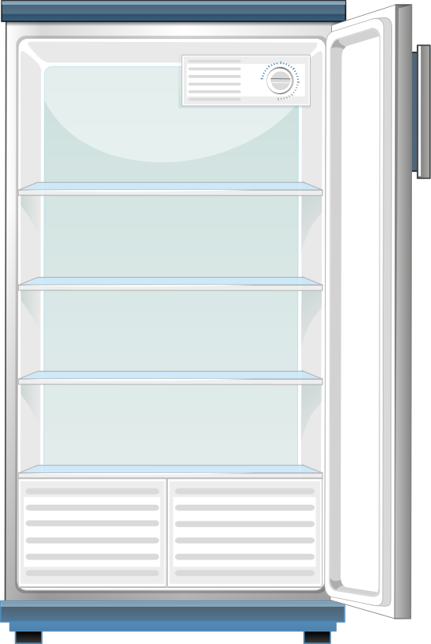

::number::
01

::default::

# On ouvre le frigo

<!--
On commence par poser le problème.
Faire un site, ça semble simple en théorie…
-->

---
layout: basic-title
---

::title::
Ce que comprend le navigateur

::default::

  
  
navigateur

  
  
  

<!--
[click] Les 3 logos + tag "navigateur" apparaissent ensemble.
HTML, CSS, JavaScript — les seuls ingrédients que le navigateur comprend nativement.
-->

---
layout: basic-title
---

::title::
Ce que vous écrivez

::default::

  

  <!-- rangée du haut -->
  
  
  
  

  <!-- rangée du bas -->
  
  
{ }

  
Aa

  
.env

<!--
TODO :
- Mettre les items sur des aliments

[click] Rangée du haut : TypeScript, React, Sass, Node — les technos principales.
[click] Rangée du bas : JS vanilla, JSON, fonts, config .env — tout le reste du frigo.
Le navigateur ne comprend rien de tout ça directement.
-->

---
layout: basic
---

  
🧑🏼‍🍳

  
bundler

<!--
TODO:
- Mettre Bundler sur le plan de travail avec assets toque de chef

[click] Le chef.
[click] Son nom : le bundler.
→ Partie 2 : par où commence-t-il ? Comment lit-il votre projet ?
-->
