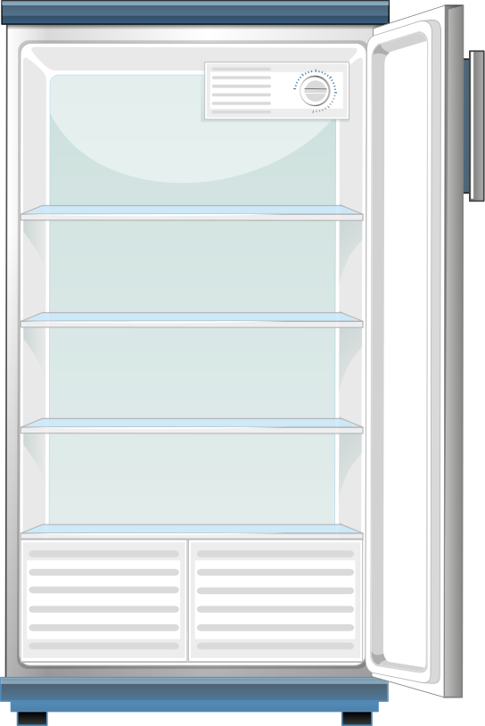

::title::
Ce que vous écrivez

::default::

  

  <!-- 3×3, technos & outils mélangés -->
  
  
  

  
  
  

  
  
  

<!--
[click] Tout ce que vous écrivez, en vrac : frameworks (React, Svelte, Vue,
Astro), langage (TypeScript, JS moderne), styles (SCSS, CSS Modules,
styled-components). Volontairement mélangé.
Le navigateur ne comprend rien de tout ça directement.
-->
