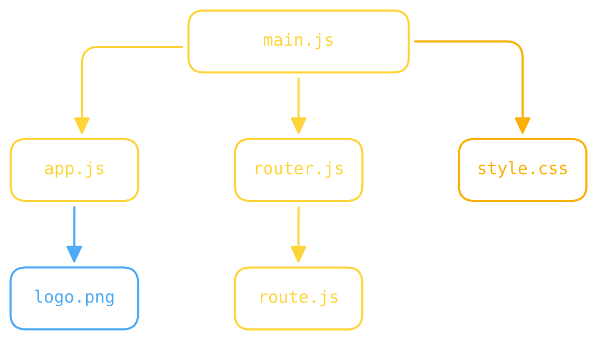

::title::
Le graphe de dépendances

::subtitle::
La carte complète de notre recette

::default::

<SlideItem src="/assets/images/items/pot_2.svg" size="100px" bottom="20px" right="40px" rotate="-8deg" opacity="0.4" />

<!--
Après toute cette découverte, on se retrouve avec un joli graphe de dépendances.

Avec ça, on voit exactement de quoi est fait notre recette : on a listé tous les fichiers — du JS, du CSS, des images — et on sait même qui a besoin de quoi.

C'est l'une des premières étapes et l'une des plus importantes.
-->
