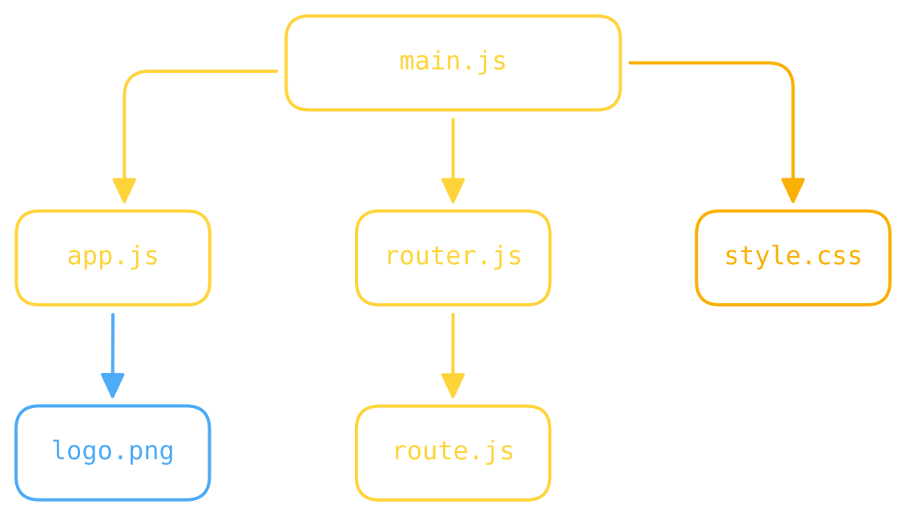

::title::
Le graphe de dépendances

::subtitle::
La carte complète de notre recette

::default::

<lucide:check-circle class="dep-graph-check" />
Savoir <strong>quoi inclure</strong> dans le bundle

<lucide:check-circle class="dep-graph-check" />
Déterminer <strong>l'ordre</strong> de chargement

<lucide:check-circle class="dep-graph-check" />
Détecter ce qui est <strong>inutilisé</strong>

<SlideItem src="/assets/images/items/pot_2.svg" size="100px" bottom="20px" right="40px" rotate="-8deg" opacity="0.35" />
<SlideItem src="/assets/images/items/pot_holder.svg" size="80px" bottom="30px" left="40px" rotate="10deg" opacity="0.25" />

<!--
Et voilà le résultat : le graphe complet de notre recette. Le bundler a une carte de tout ce qui existe dans notre application.

Avec ça, il sait exactement quoi inclure dans le bundle final, dans quel ordre charger les fichiers, et surtout — ce qu'on verra plus tard — il peut détecter ce qui est inutilisé pour l'éliminer.

C'est la fondation de tout ce qui va suivre. On a tout ce qu'il nous faut, passons à la transformation.
-->
