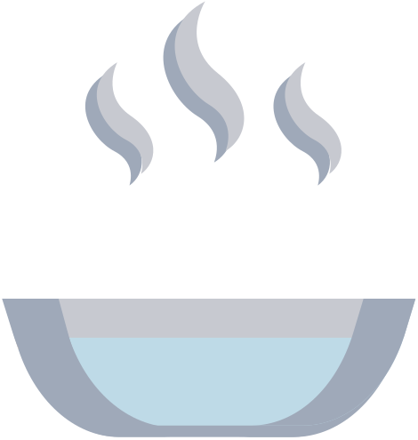

  

    
🎭 Répétition

    

      
      
      
      
      
    

    
Vitesse &gt; esthétique On goûte, on ajuste, on refait.

  

  
vs

  

    
🍽️ Service

    

      
    

    
L'assiette finale. Le client ne voit que ça.

  

<!--
La métaphore visuelle qui porte tout le message de la partie 6.

À gauche : la répétition. Une cuisine en mouvement, des ustensiles
éparpillés, le chaos productif. Ce qui compte : la vitesse de feedback,
pas l'esthétique.

À droite : le service. L'assiette qu'on a déjà vue dans la partie 01 (où
elle représentait ce que le navigateur comprend). Elle revient ici comme
le résultat final, présenté au client. Callback narratif fort.

À l'oral : "Vous vous souvenez de cette assiette ? C'était au tout début,
on parlait de ce que le navigateur comprend. Eh bien c'est la même
assiette qui est servie au client à la fin."
-->
