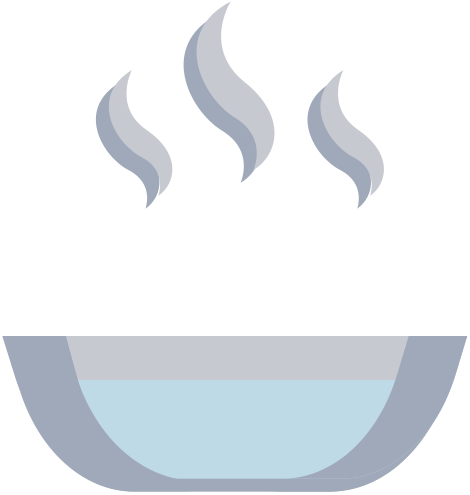

  

    
Répétition

    

      
      
      
      
      
    

    
On goûte, on ajuste, on refait. Le retour doit être rapide.

  

  
vs

  

    
Service

    

      
    

    
L'assiette finale. L'utilisateur ne voit que ça.

  

<!--
Le fil rouge de la partie : le même projet passe par deux cuisines.

À gauche, la répétition (le dev). On goûte, on ajuste, on refait : ce qui compte, c'est la vitesse du retour.

À droite, le service (la prod). C'est l'assiette de la partie 01, servie au client : il ne voit que le résultat.

Les outils se comportent différemment dans chacune. On le voit en trois temps : comment le dev reste rapide, ce que reçoit le navigateur, comment déboguer ce qui part en prod.
-->
